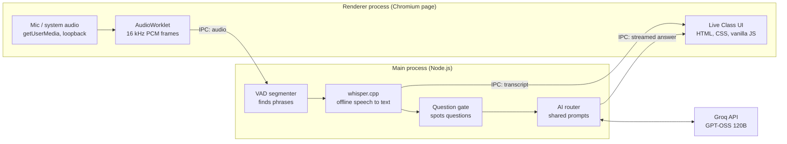

# Live Class: how it works

Live Class is a floating overlay for teaching. It listens to the class, writes down what is said, spots questions
and answers them with the same AI service, model, subject and prompts as the Private Assistant.

```bash
npm run liveclass
```

It is a normal window: it is **not** hidden from screen sharing or recording.

## Contents

1. [What you see](#what-you-see)
2. [Architecture](#architecture)
3. [The app shell: Electron](#1-the-app-shell-electron)
4. [Capturing sound: Web Audio API](#2-capturing-sound-web-audio-api)
5. [Finding phrases: voice activity detection](#3-finding-phrases-voice-activity-detection)
6. [Speech to text: whisper.cpp, offline](#4-speech-to-text-whispercpp-offline)
7. [Spotting the question](#5-spotting-the-question)
8. [The AI: Groq and the shared prompts](#6-the-ai-groq-and-the-shared-prompts)
9. [The UI](#7-the-ui)
10. [Settings and keys](#8-settings-and-keys)
11. [Making it real time](#making-it-real-time)
12. [File map](#file-map)
13. [Known limits and next steps](#known-limits-and-next-steps)

## What you see

| Part | What it does |
|---|---|
| Toolbar | Mic on/off and audio source (Microphone, System audio, both), **Answer** `Ctrl+Enter`, **Screenshot** `Ctrl+Shift+Enter`, **Chat** `Ctrl+Shift+Space`, move handle, collapse, session timer, ⋮ settings, **End**, **Quit** (✕, `Ctrl+Q`) |
| Transcript strip | Mic activity bars, the latest phrases heard, and a live "speaking…" / "writing it down…" indicator. Click a phrase ending in "?" to answer it |
| Answer card | "Question: …" and "Answer: …" with bullet points, streamed word by word. `Ctrl+←` / `Ctrl+→` move through earlier questions. Footer: time, 👍 / 👎 |
| Settings (⋮) | AI in use, Dashboard link, Zoom, Theme (light/dark), Opacity, Font size, Language, Auto Answer, Edit question |

- **End** stops listening and shows a summary, with **Start again**.
- **Quit** closes the window and stops the speech engine.

## Architecture



Every Electron app has two kinds of process, and this split runs through the whole app:

- **The main process (Node.js)** does the heavy and private work: the speech engine, the AI calls and the API keys.
- **The renderer (Chromium)** only draws the window and captures sound.

## 1. The app shell: Electron

**Technology:** Electron 31 (Chromium plus Node.js in one desktop app).

**The window.** [liveclass-main.js](../liveclass-main.js) creates it as a `BrowserWindow` with:
- `frame: false`, `transparent: true` and `alwaysOnTop: true`, which make it a floating overlay;
- the CSS property `-webkit-app-region: drag` on the move handle, so a window with no title bar can still be dragged.

**How the two processes talk.**
- The page runs with `contextIsolation` and cannot touch Node or Electron directly.
- [liveclass-preload.js](../liveclass-preload.js) uses `contextBridge` to give it a small, fixed set of functions as `window.liveClassAPI`.
- Those functions are IPC messages:
  - `ipcRenderer.invoke` / `ipcMain.handle` for request and response (`lc:info`);
  - `send` / `on` for streams: audio in (`lc:audio`); transcript, status and answer events out (`pipeline`, `engine`).
- Every handler checks `fromWin(event)`, so only this window can drive the engine.

API keys stay in the main process and never reach the page.

## 2. Capturing sound: Web Audio API

**Code:** [renderer/capture.js](../renderer/capture.js), shared with the Private Assistant.

**Where the sound comes from.**
- **Microphone:** `navigator.mediaDevices.getUserMedia`.
- **System audio** (what Teams or Zoom plays): `getDisplayMedia`. The main process answers that request with `audio: 'loopback'` in `session.setDisplayMediaRequestHandler`, which is Windows' native audio loopback. The video track is dropped straight away.

**How it is prepared.**
- `new AudioContext({ sampleRate: 16000 })` resamples the sound to 16 kHz, the rate Whisper expects.
- An **AudioWorklet** runs on the audio thread. It mixes to mono and emits 100 ms blocks (1,600 samples).
- Each block becomes an `Int16Array` (raw 16-bit PCM) and is sent to the main process over IPC.

## 3. Finding phrases: voice activity detection

**Code:** [src/audio/vad.js](../src/audio/vad.js), an energy-based voice activity detector (VAD). It uses loudness only, no ML.

| Step | How |
|---|---|
| Measure | Audio is cut into 20 ms frames and each frame's loudness is measured in dB |
| Noise floor | A running estimate of the background level, updated only while nobody is talking |
| Speech | A frame counts as speech when it is 12 dB above the noise floor (and above −48 dB) |
| Start | 4 loud frames in a row (80 ms). 300 ms of audio from just before is kept, so the first word is not clipped |
| End | A pause of `hangMs` (Live Class: **600 ms**) |
| Long speech | Cut at a natural gap after 5 s, or at the quietest moment by 8 s. Never in the middle of a word |

The "speaking…" indicator in the strip comes straight from this detector's state (`pipeline` `level` events), which is why it appears instantly.

## 4. Speech to text: whisper.cpp, offline

**Technology:** whisper.cpp, a C++ port of OpenAI's Whisper model.

**How it runs.**
- `whisper-server.exe` runs as a separate process on `127.0.0.1`, on a free port.
- [src/stt/whisperServer.js](../src/stt/whisperServer.js) starts it and posts each phrase as a WAV file to `/inference`.
- No audio leaves the computer.

**Model.** Live Class uses `ggml-base.en-q5_1.bin`:
- `ggml` is whisper.cpp's model format.
- `base.en` is the English-only base model.
- `q5_1` means 5-bit quantized, so the file is about 57 MB.

The Private Assistant keeps the model chosen in its Settings (`small.en`). If `base.en` is missing, Live Class falls back to that model.

**Engine settings for Live Class** (`LIVE_WHISPER_ARGS`):

| Flag | Meaning | Why |
|---|---|---|
| `-ac 512` | Audio context of about 10 s instead of the full 30 s | Less work per phrase. Phrases are at most 8 s, so nothing is lost. A smaller value (448) started losing punctuation on 8 s phrases, including question marks |
| `-bo 1` | Keep 1 candidate instead of 2 | Faster decoding |
| `-nf` | No temperature fallback | No slow retries |

**Vocabulary hint.** The class subject is sent as the prompt (`Topic: Power Platform, Dataverse, …`). This helps the model spell subject terms correctly.

**Clean-up** (`cleanTranscript`, `isHallucination` in [src/ai/questions.js](../src/ai/questions.js)):
- Phrases Whisper invents from silence, such as "Thank you for watching", are dropped.
- So are repeated lines, for example when the mic picks up the speakers.

## 5. Spotting the question

**Code:** [src/ai/questions.js](../src/ai/questions.js) and [src/pipeline.js](../src/pipeline.js).

**When Auto Answer is on**, the `QuestionGate`:
- collects what was heard;
- waits for **0.5 s** of quiet in Live Class (1 s in the assistant), or at most 0.4 s when the phrase ends with "?";
- checks the text against question patterns (`looksLikeQuestion`);
- skips a question that was already answered in the last 90 s.

**When several questions were said at once**, one extra AI call (`EXTRACT_PROMPT` in [src/ai/framing.js](../src/ai/framing.js)) splits and rewords them.

**Answer (`Ctrl+Enter`)** works like "Question finished":
- the phrase still being spoken is finished off first;
- everything heard since the last answer is handed to the AI (`completeQuestion`).

## 6. The AI: Groq and the shared prompts

**Routing.** [src/ai/router.js](../src/ai/router.js) (`AnswerRouter`) chooses Groq, Gemini or Claude from Settings. Switching provider needs no code change.

**The Groq call.** [src/ai/groq.js](../src/ai/groq.js) calls Groq's OpenAI-compatible endpoint:
- `POST https://api.groq.com/openai/v1/chat/completions`
- `stream: true`, plus `reasoning_effort: 'low'` for GPT-OSS models.

**Streaming.** The answer arrives as server-sent events, which are parsed piece by piece. Each piece reaches the page as an `answer-delta` event, so the answer appears word by word.

**The prompt.** `SYSTEM_PROMPT` in [src/ai/answerer.js](../src/ai/answerer.js) is shared by every provider and by the Private Assistant. The user message carries:
- the class subject;
- recent class speech, as context;
- the last 4 questions and answers from the past 45 minutes, so follow-up questions make sense.

**Running several answers.**
- Up to 3 answers run in parallel.
- Each has an `AbortController`, so an old one can be cancelled.
- Errors are turned into plain messages by `friendlyError`: bad key, quota (429), network.

**Screenshot.**
- `desktopCapturer` grabs the screen the mouse is on. The Live Class window hides for a moment, so it is not in the picture.
- The picture is sent as a PNG to the screen-capture AI from Settings (Gemini).
- Each question found in it is answered like a spoken one.

## 7. The UI

**Technology:** plain HTML, CSS and JavaScript, no framework.
- [liveclass-window.html](../liveclass-window.html) holds the page and its styles.
- [renderer/liveclass-ui.js](../renderer/liveclass-ui.js) holds the behaviour.

**Settings controls.**

| Control | How it works |
|---|---|
| Theme | Colours are CSS variables on `:root`, swapped under `[data-theme="light"]` |
| Zoom | CSS `zoom` on the overlay |
| Opacity | CSS `opacity` on the overlay |
| Font size | A CSS variable |

**Answer layout.** [src/format.js](../src/format.js) splits an answer into one statement per line:
- list items become bullets;
- code blocks are kept as they are.

The same file runs in Node and in the browser (a UMD module).

**Security.**
- Everything the AI writes is inserted with `textContent`, never `innerHTML`, so AI output cannot inject HTML or scripts.
- A Content-Security-Policy allows scripts only from the app itself, plus `blob:` for the AudioWorklet.

**Demo mode.** Opened in a plain browser (no `window.liveClassAPI`), the page uses `demoAPI()`, which plays sample data. This is how the UI can be previewed without Electron.

## 8. Settings and keys

**Settings.**
- They are shared with the Private Assistant: `%APPDATA%\teacher-notes-app\settings.json`. They cover subject, provider, model, thinking time, audio source and Auto Answer.
- Change them in the Private Assistant (`npm start`) under Settings.
- Auto Answer changed inside Live Class lasts for that session only.

**Keys.** API keys are encrypted with Electron's `safeStorage`, which uses Windows DPAPI, and are never written in plain text.

## Making it real time

Measured on the development PC. A Windows voice says a 9 s sentence ending in a question, and the clock runs from the end of speech until the question is ready for the AI.

| Setup | Question ready |
|---|---|
| Private Assistant settings (`small.en`, 0.8 s pause, 1 s quiet) | 4.8 s after speech ends |
| Live Class tuning, `small.en` | 3.4 s |
| **Live Class tuning, `base.en` (current)** | **1.6 s** |

Groq then usually starts writing within another 0.5 to 1.5 s.

**Speech model comparison.** Both models used the Live Class settings and the class subject as a hint. The test set was 40 clips: 10 Power Platform questions, spoken by 2 Windows voices at 2 speeds.

| | `small.en-q5_1` | `base.en-q5_1` |
|---|---|---|
| Time per phrase (median) | 2.6 s | **0.7 s** |
| Word accuracy | **98.5 %** | 95.5 % |
| Question marks kept | 36 / 36 | 36 / 36 |
| Typical mistakes | "Okay" written as "OK" | "C sharp" → "AC Sharp", "in Dataverse" → "and Dataverse" |

Windows voices are cleaner than real classroom speech, so real accuracy will be lower for both models. The AI usually still understands small slips like these.

**Tried and dropped: live words while someone is still speaking.**
- Each preview costs a full speech-engine call of about 2 s.
- That call held up the finished phrase.
- So the strip shows an instant "speaking…" indicator instead.

## File map

| File | Role |
|---|---|
| [liveclass-main.js](../liveclass-main.js) | Main process: window, media permissions, speech engine (Live Class tuning), AI router, screen capture, IPC |
| [liveclass-preload.js](../liveclass-preload.js) | `window.liveClassAPI`, the only bridge between page and main process |
| [liveclass-window.html](../liveclass-window.html) | Page structure and styles (dark and light themes) |
| [renderer/liveclass-ui.js](../renderer/liveclass-ui.js) | UI behaviour, shortcuts, settings menu, event handling, demo mode |
| [renderer/capture.js](../renderer/capture.js) | Microphone / system-audio capture to 16 kHz PCM (shared) |
| [src/pipeline.js](../src/pipeline.js) | Glue: audio → phrases → text → questions → answers, as events (shared) |
| [src/audio/vad.js](../src/audio/vad.js) | Voice activity detector (shared) |
| [src/stt/whisperServer.js](../src/stt/whisperServer.js) | Starts and talks to whisper.cpp (shared) |
| [src/ai/](../src/ai/) | Question detection, prompts, Groq / Gemini / Claude clients, router (shared) |
| [src/format.js](../src/format.js) | One-statement-per-line answer format (shared) |

A good order for reading the code is `capture.js` → `vad.js` → `pipeline.js` → `groq.js`.

## Known limits and next steps

- **Screenshot** captures the whole screen. Drawing a box around one question is not supported yet.
- **No licence check**, the same as the mock interview window. It is also not part of the installer (`build.files` in `package.json`).
- **Language** follows the speech model, which is English-only. The selector is locked in the app.
- **Ideas:**
  - a GPU build of whisper.cpp, for `small.en` accuracy at `base.en` speed;
  - a faster Groq model for quicker first words;
  - saving Live Class sessions with the existing export.
